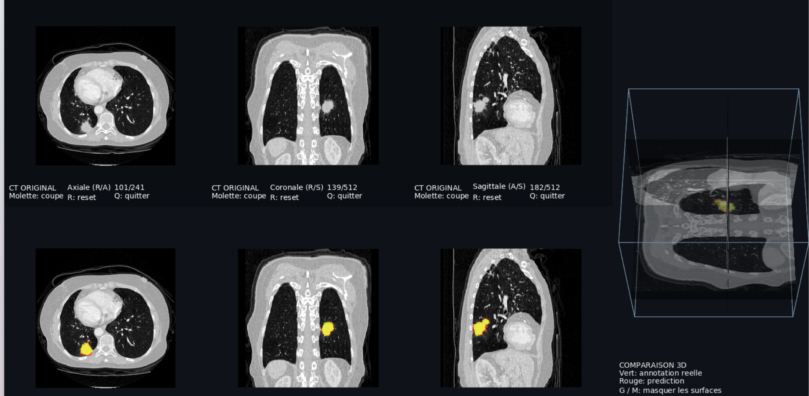

# Small Tumor — Approche multi-architectures pour la segmentation 3D et la quantification volumétrique des tumeurs pulmonaires

Un projet expérimental consacré à l'entraînement et à l'évaluation de modèles de segmentation sur scanners CT thoraciques. Il étudie la localisation des tumeurs pulmonaires, la qualité des masques prédits et l'estimation de leur volume. Une première référence utilise nnU-Net ; d'autres architectures seront ajoutées progressivement.

Le projet combine visualisation **VTK**, métriques en unités physiques, statistiques de probabilité et un premier sélecteur de régions supervisé par un **oracle**. L'objectif est de distinguer les erreurs de contour des erreurs de sélection : une région pertinente peut déjà être présente dans la prédiction, accompagnée de régions parasites.

**État actuel : prototype de recherche, un seul fold nnU-Net entraîné.** Les expériences ne constituent pas un dispositif médical ni une validation clinique.



_Exemple qualitatif avec les outils du projet. En haut : scanner original. En bas : superposition des masques. Vert : annotation seule ; rouge : prédiction seule ; jaune : recouvrement. À droite : surfaces et plans de coupe en 3D. Cette capture illustre un cas, pas la performance moyenne. Source des données : Medical Segmentation Decathlon, Task06_Lung, CC BY-SA 4.0 ; voir les crédits en fin de document._

## Ce que contient le projet

| Partie          | Fonctionnalités                                                                           |
| --------------- | ----------------------------------------------------------------------------------------- |
| Préparation     | Conversion officielle MSD → nnU-Net v2, vérification des données, partitions sauvegardées |
| Entraînement    | Référence `3d_fullres`, essais courts et entraînement de 100 époques sur le fold 0        |
| Évaluation      | Métriques par patient, distances en mm, volumes en mL, résumés et bootstrap               |
| Post-traitement | Plus grande composante, sélection anatomique heuristique, oracle et sélecteur appris      |
| Probabilités    | Contrôle des axes et statistiques par région : moyenne, quantiles, entropie               |
| Visualisation   | CT, annotations, prédictions, recouvrements, régions et scores de classement dans VTK     |

Les essais négatifs sont conservés : une règle qui améliore la distance de surface peut aussi supprimer la vraie cible. Le projet compare donc les résultats **patient par patient**, sans se limiter à une moyenne.

## Données et protocole

Le jeu utilisé est **Task06_Lung** du [Medical Segmentation Decathlon](https://registry.opendata.aws/msd/). La cible est la tumeur, avec des labels binaires `0 = fond` et `1 = cancer` ; les masques ne délimitent pas les poumons entiers.

L'archive locale auditée contient :

| Sous-ensemble           | Patients | Annotations publiques | Usage actuel               |
| ----------------------- | -------: | --------------------- | -------------------------- |
| `imagesTr` + `labelsTr` |       63 | Oui                   | Entraînement et validation |
| `imagesTs`              |       32 | Non                   | Inférence qualitative      |

Les effectifs ci-dessus sont ceux de l'archive effectivement utilisée, et non une reprise de l'effectif annoncé par certaines descriptions du dataset.

Les cinq partitions sont enregistrées dans [`configs/nnunet/splits_final.json`](configs/nnunet/splits_final.json). **Seul le fold 0 est entraîné actuellement** : 50 patients d'entraînement, 13 de validation. Les 32 patients test n'interviennent pas dans les scores de segmentation : leurs annotations ne sont pas publiques.

### Référence nnU-Net

- nnU-Net v2, configuration `3d_fullres`, réseau `PlainConvUNet`.
- Entraînement de 100 époques, après un test de fonctionnement de 5 époques.
- Plan `nnUNetPlans_6GB`, cible mémoire de 6 Go ; patch `64 × 160 × 160` dans l'ordre interne nnU-Net, batch de 2.
- Données rééchantillonnées selon le plan ; prédictions réexportées dans la géométrie originale.
- Sorties **final** et **best** conservées dans des dossiers distincts. Les expériences actuelles de probabilités et de sélecteur utilisent **best**.

Le plan adapté à la mémoire est une configuration expérimentale documentée, pas une reproduction à l'identique du planning nnU-Net par défaut. La normalisation CT est déterminée par le prétraitement nnU-Net.

## Premiers résultats

Moyennes par patient sur les **13 patients de validation**, à partir du checkpoint **best**. Pour le sélecteur, chaque patient est prédit par un modèle ajusté sur les 12 autres ; le modèle final entraîné sur les 13 n'est pas utilisé pour ce tableau.

| Métrique                         | nnU-Net best brut | Sélecteur appris, patient exclu |
| -------------------------------- | ----------------: | ------------------------------: |
| Dice ↑                           |             0,586 |                           0,666 |
| Surface Dice à 2 mm ↑            |             0,593 |                           0,696 |
| HD95 en mm ↓                     |            141,80 |                           31,13 |
| Erreur absolue de volume en mL ↓ |              8,50 |                            4,93 |

Le sélecteur retrouve le choix oracle pour **11 patients sur 13**. Il échoue toutefois sur `lung_006` et `lung_042`, où la composante retenue ne recouvre pas l'annotation : le Dice devient nul. Les prédictions brutes sont conservées et le visualiseur de scores affiche désormais **toutes les régions**, sans suppression automatique.

**Ces résultats restent exploratoires.** Les patients de validation ont aussi servi à sélectionner le checkpoint du réseau principal. La validation par patient du sélecteur ne supprime pas ce biais amont. Le bootstrap apparié du gain de Dice inclut zéro : aucune amélioration générale ou significative n'est revendiquée sur cette petite cohorte.

Sources des nombres : `validation_best_probabilities/evaluation_metrics.json` et `experiments/region_selector_v1/loo_predictions/{evaluation_metrics,comparison_to_raw}.json`, générés localement hors du dépôt.

## Oracle, nettoyage et sélection apprise

### Oracle : une référence diagnostique

L'oracle choisit la composante prédite ayant le **meilleur Dice avec l'annotation complète**, puis conserve cette composante entière. Il ne découpe pas le masque avec la ground truth et ne récupère pas du tissu absent de la prédiction.

Cette expérience mesure ce que permettrait une sélection idéale parmi les composantes existantes. **Elle utilise la réponse réelle : ce n'est ni un post-traitement déployable ni un résultat de test indépendant.**

### Sélecteur automatique supervisé par l'oracle

Le prototype apprend à reconnaître la composante choisie par l'oracle à partir de dix caractéristiques : volume, volume relatif, position RAS normalisée, remplissage de boîte et statistiques de probabilité. Aucun Dice, recouvrement avec l'annotation ou identifiant de patient n'entre dans les caractéristiques.

Le modèle est une régression logistique régularisée, précédée d'une standardisation ajustée uniquement sur les patients d'entraînement de chaque essai. Le `selector_score` est une **note de classement non calibrée**, différente de la probabilité voxel de nnU-Net.

La sélection par taille seule et l'heuristique de proximité pulmonaire ont aussi été testées. Elles peuvent garder une région parasite et supprimer la cible : elles restent des comparaisons expérimentales, pas des règles fiables.

## Métriques et conventions

- **Dice**, rappel et précision voxel.
- **Surface Dice à 2 mm**, pondéré par l'aire des surfaces.
- **HD95 symétrique en mm** : maximum des deux percentiles 95 dirigés, pondérés par les aires ; implémentation [surface-distance](https://github.com/google-deepmind/surface-distance).
- Volumes annoté et prédit en **mL** ; erreurs signée, absolue et relative. Le biais signé vaut prédiction moins annotation.
- Régions détectées, manquées et supplémentaires : composantes 26-connexes, appariement maximal un-à-un avec recouvrement non nul.
- Résumé macro par patient, médiane, quartiles, écart-type et intervalles bootstrap descriptifs à 95 %.

Une composante connexe n'est pas nécessairement une lésion anatomique distincte. Les fragments d'annotation et le critère permissif de recouvrement sont explicités dans les rapports. Deux masques vides donnent Dice/Surface Dice = 1 et HD95 = 0 ; un seul vide donne Dice/Surface Dice = 0 et HD95 = `null`, avec statut et dénominateurs explicites.

Les métriques physiques utilisent la géométrie d'origine des NIfTI. Les tableaux NiBabel sont en XYZ ; les probabilités exportées avec le lecteur nnU-Net SimpleITKIO sont en CZYX. La conversion est explicite et contrôlée contre le masque prédit.

## Organisation

```text
.
├── README.md
├── docs/images/                    # Capture utilisée dans ce README
├── configs/nnunet/                 # Plans, partitions, lanceurs et versions
├── postprocessing/                 # Évaluation, expériences et sélecteur
│   ├── evaluate.py
│   ├── compare_evaluations.py
│   ├── oracle_select_region.py
│   ├── region_probability_stats.py
│   ├── train_region_selector.py
│   └── apply_region_selector.py
├── visualization/                  # Afficheurs VTK et documentation
│   ├── view_scan.py
│   ├── view_prediction.py
│   ├── view_comparison.py
│   └── view_region_scores.py
```

Les NIfTI, archives, cartes de probabilités, checkpoints, modèles du sélecteur et rapports détaillés générés par patient restent **hors du dépôt**. Les fichiers JSON d’évaluation sont créés localement par les scripts, pas distribués avec le code. Les chemins par défaut reposent sur le dossier utilisateur :

```text
~/Datasets/
├── MedicalSegmentationDecathlon/Task06_Lung/extracted/Task06_Lung/
└── nnUNet/
    ├── nnUNet_raw/Dataset006_Lung/
    ├── nnUNet_preprocessed/Dataset006_Lung/
    ├── nnUNet_results/baseline_100epochs_fold0_20261029/
    ├── predictions/baseline_100epochs_fold0_best/
    └── experiments/region_selector_v1/
```

## Installation

Environnement testé : Windows 11, Python 3.12, RTX 4060 Laptop 8 Go, RAM 16 Go. Versions principales observées : PyTorch `2.11.0+cu128`, nnU-Net `2.8.1`, VTK `9.7.1`, scikit-learn `1.8.0`.

Depuis la racine du clone, dans **PowerShell** :

```powershell
python -m venv .venv
$py = Join-Path (Get-Location) ".venv\Scripts\python.exe"
& $py -m pip install --upgrade pip
```

Installer d'abord la version de PyTorch adaptée au matériel en suivant les [instructions officielles](https://pytorch.org/get-started/locally/), avec cet interpréteur. Vérifier ensuite CUDA :

```powershell
& $py -c "import torch; print(torch.__version__); print('CUDA:', torch.cuda.is_available())"
```

Installer la révision nnU-Net utilisée et les dépendances du projet ; l'installation depuis Git nécessite Git :

```powershell
& $py -m pip install "nnunetv2 @ git+https://github.com/MIC-DKFZ/nnUNet.git@1489d746e084459581ff20382c1241d8cc2eb258"
& $py -m pip install -r postprocessing\requirements.txt -r visualization\requirements.txt
```

L'appel direct de l'interpréteur du venv évite de dépendre de l'activation d'un script PowerShell. L'inventaire [`environment_snapshot.json`](configs/nnunet/environment_snapshot.json) décrit la session mesurée ; ce n'est pas un verrou complet garantissant des résultats identiques sur toute machine. Les lanceurs ont été vérifiés sous Windows, sans garantie de portabilité de l'ensemble du workflow.

## Exécuter le pipeline

Télécharger et extraire Task06_Lung séparément depuis la source officielle. Les données et les poids ne sont pas fournis avec le dépôt.

### 1. Conversion et préparation

Configurer les trois chemins nnU-Net dans le terminal, puis lancer le convertisseur officiel sur les données MSD extraites :

```powershell
$storage = Join-Path $env:USERPROFILE "Datasets\nnUNet"
$env:nnUNet_raw = Join-Path $storage "nnUNet_raw"
$env:nnUNet_preprocessed = Join-Path $storage "nnUNet_preprocessed"
$env:nnUNet_results = Join-Path $storage "nnUNet_results"
New-Item -ItemType Directory -Force -Path $env:nnUNet_raw, $env:nnUNet_preprocessed, $env:nnUNet_results | Out-Null
$msd = Join-Path $env:USERPROFILE "Datasets\MedicalSegmentationDecathlon\Task06_Lung\extracted\Task06_Lung"
& ".\.venv\Scripts\nnUNetv2_convert_MSD_dataset.exe" -i "$msd" -np 2
& $py configs\nnunet\prepare.py --check
& $py configs\nnunet\prepare.py
```

Ne pas reconvertir un ID déjà présent. Le prétraitement est réutilisable pour les entraînements partageant les mêmes plans ; il ne faut pas le refaire à chaque essai.

### 2. Entraînement et inférence best sur la validation

```powershell
& $py configs\nnunet\train_100epochs.py
& $py configs\nnunet\predict_validation_best.py --check
& $py configs\nnunet\predict_validation_best.py
```

Ces étapes s'exécutent **successivement** : attendre la fin de l'entraînement et de sa validation avant de lancer une nouvelle inférence GPU. Les lanceurs refusent certaines sorties existantes et proposent `--resume` pour une reprise adaptée. Les noms d'essais et certains chemins restent spécifiques à l'expérience actuelle ; les adapter avant une nouvelle campagne.

### 3. Statistiques, oracle et sélecteur

```powershell
& $py postprocessing\region_probability_stats.py
$fold = Join-Path $storage "nnUNet_results\baseline_100epochs_fold0_20261029\Dataset006_Lung\nnUNetTrainer_100epochs__nnUNetPlans_6GB__3d_fullres\fold_0"
$best = Join-Path $fold "validation_best_probabilities"
& $py postprocessing\oracle_select_region.py --input-dir "$best"
& $py postprocessing\train_region_selector.py --prediction-dir "$best"
```

L'inférence best lance son évaluation à la fin. Le lanceur du sélecteur crée ses propres masques de validation par patient et les évalue séparément. Les options de sortie permettent de conserver plusieurs expériences sans écraser les précédentes.

### 4. Visualisation

```powershell
& $py visualization\view_comparison.py --prediction-file "$best\lung_006.nii.gz"
& $py visualization\view_comparison.py --prediction-file "$best\oracle_best_overlap\lung_006.nii.gz"
& $py visualization\view_region_scores.py --case lung_006
```

Le visualiseur de scores conserve toutes les régions : orange pour la mieux classée, rouge pour les autres, cyan pour la région parcourue. `N/B` permet de les examiner et `T` de revenir sur l'annotation. Un faible score ne déclenche aucune suppression dans cet outil.

Guides détaillés : [configuration nnU-Net](configs/nnunet/README.md), [évaluation et post-traitement](postprocessing/README.md), [visualisation VTK](visualization/README.md).

## Vérifications

```powershell
& $py -m unittest discover -s postprocessing -v
& $py -m unittest discover -s visualization -v
& $py visualization\check_region_scores_render.py
```

Les tests couvrent notamment les distances anisotropes, les masques vides, l'appariement des régions, les axes des probabilités, la séparation des patients et la conservation des régions dans les afficheurs. Le test de rendu nécessite un environnement VTK capable de rendre une scène.

## Suite du projet

- Entraîner les cinq folds et constituer des prédictions hors entraînement pour les 63 patients annotés.
- Étendre l'apprentissage du sélecteur au-delà des 13 patients actuels, avec une évaluation séparée.
- Améliorer la reconnaissance anatomique des candidates, en étudiant notamment leurs patches CT.
- Tester le raffinement à haute résolution et comparer qualité, volume, temps et mémoire.
- Renforcer la configuration des expériences et la portabilité des chemins et dépendances.

Ces étapes sont des objectifs futurs ; elles ne sont pas présentées comme déjà réalisées.

## Sources et licences

- [nnU-Net — MIC-DKFZ](https://github.com/MIC-DKFZ/nnUNet) : framework de segmentation utilisé pour la référence.
- [Medical Segmentation Decathlon — registre AWS](https://registry.opendata.aws/msd/) : source des données Task06_Lung ; licence [CC BY-SA 4.0](https://creativecommons.org/licenses/by-sa/4.0/).
- [surface-distance — Google DeepMind](https://github.com/google-deepmind/surface-distance) : calcul des métriques de surface.

La capture fournie dans ce README est une visualisation de données Task06_Lung réalisée avec les outils du projet ; elle est attribuée à cette source et diffusée sous CC BY-SA 4.0. Les données et dépendances conservent leurs licences respectives. La licence du code propre à ce dépôt reste à définir.
